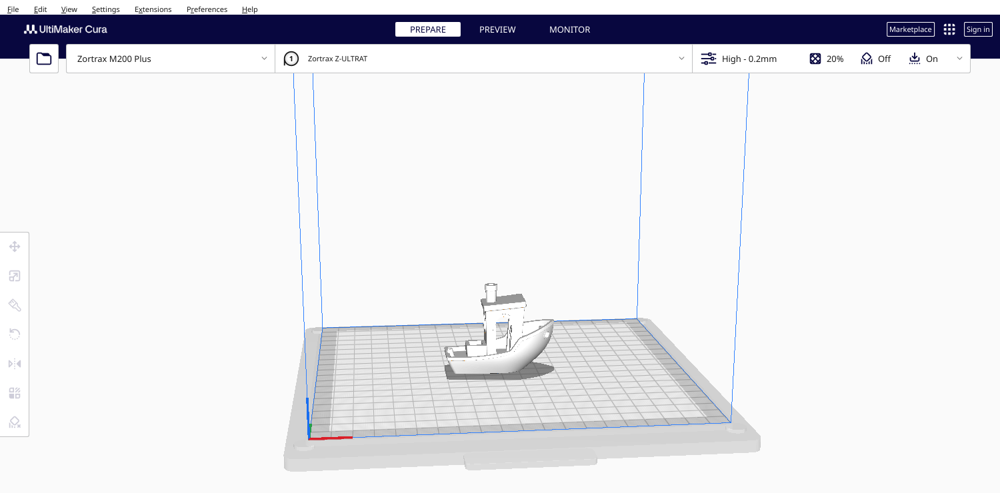
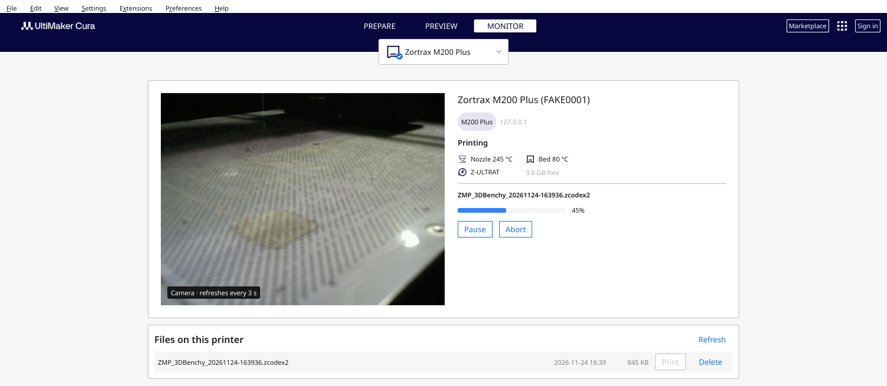

<p align="center">
  <picture>
    <source media="(prefers-color-scheme: dark)" srcset="docs/images/zura-logo-dark.svg">
    
  </picture>
</p>

# Zura: Zortrax M-series support for Cura

A Cura plugin for Zortrax's M200 Plus, M300 Plus and the original M200 and M300: Zortrax's own material and quality profiles, native `.zcodex2`/`.zcode` output, and network printing with a live Monitor tab. Targets Cura 5.14 (SDK 8.13).

Zura is an unofficial community plugin. It isn't affiliated with Zortrax or UltiMaker.

<p align="center">
  
  
</p>
<p align="center"><sub>Left: a Benchy on the M200 Plus with Z-ULTRAT. Right: the Monitor tab mid-print (captured against the repo's test printer, using a frame from a real M200 Plus camera).</sub></p>

## What works
- **Machines**: Zortrax M200 Plus (200 × 200 × 180 mm) and M300 Plus (300 × 300 × 300 mm), 0.4 mm nozzle, 1.75 mm filament, with build-plate meshes. The M300 Plus shares the M200 Plus presets because Z-Suite's profiles for the two are identical.
- **Presets**: 16 materials from Zortrax's catalogue and 113 quality profiles generated from Z-Suite 3.7.0's own configurations (`tools/gen_presets.py`), split Cura-style into printer defaults, filament settings and quality profiles (see `docs/presets.md`).
- **Original M200 and M300**: their own machines with Z-Suite 2.32's Zortrax filament profiles (M200: 10 filaments, 79 profiles; M300: 7 filaments, 54 profiles), saved as classic `.zcode` for the SD card. The compiler matches Z-Suite 2.32 byte for byte (see `docs/zcode-format.md`).
- **Output**: native `.zcodex2` writer. Cura's G-code is translated into Zortrax's binary command stream, with Z-Suite's start/end sequence, feature tags, progress reports and an encrypted `ConfigurationData` entry. See `docs/zcodex2-format.md`.
- **LAN printing**: printers on the network appear in Cura's Add printer screen (or add by IP), send & print over FTP, Monitor tab with camera snapshot, temperatures, progress, pause/resume/abort, loaded-filament sync with a mismatch warning, and a list of files on the printer (print or delete).
- **Pause at height**: Cura's Pause at height script becomes a native Zortrax pause.

## Tested
- **Real M200 Plus** (firmware 2.6.15): a Cura-sliced 3DBenchy in Z-ULTRAT printed start to finish from a Zura `.zcodex2`. Cura's Print over network button and the Monitor tab (camera, live progress through to a finished print, file list) work on it too.
- **Real original M200**: a Zura-sliced 20 mm cube printed fine from a `.zcode`.
- **Headless Cura 5.14**: add printer, slice, save `.zcodex2` (parses cleanly with Z-Suite's own command classes), and the whole network flow against `tests/fake_printer`.

## Not yet
- Original M300 on real hardware.
- M300 Plus on real hardware (header model id 50 and firmware 2.6.0 are from Z-Suite but untested).
- M300 Dual (dual extrusion).

## Install
Download `ZortraxM-<version>.curapackage` from the [Releases](../../releases) page (or build it with `python3 tools/build_package.py`, which writes it to `dist/`), drag it onto Cura's window, then restart Cura. For development on macOS, `./install_mac.sh` links the plugin folder into Cura instead.

Then add the printer from Add printer (it shows up under networked printers) or pick **Zortrax M200 Plus** / **M300 Plus** from the non-networked list. To connect a printer you added by hand: Preferences → Printers → Connect via Network. Save files with "Save to Disk" (format: Zortrax ZCodex2). For the original M200 or M300 pick **Zortrax M200** / **Zortrax M300**; files save as `.zcode` to copy to the SD card.

## Develop
```sh
python3 tests/test_zcodex.py           # unit tests (needs `cryptography` only for tests)
python3 tools/gen_presets.py           # regenerate materials/quality from zsuite_profiles
python3 tools/gen_classic_presets.py   # regenerate the original M200/M300 machines and their quality profiles
python3 tools/zcodex2_inspect.py FILE  # dump a .zcodex2
python3 tools/compare_zcodex.py A B    # compare two .zcodex2 files (e.g. Cura vs Z-Suite)
python3 tools/gen_platform.py          # regenerate the build-plate meshes
python3 tools/build_package.py         # build the .curapackage
```
