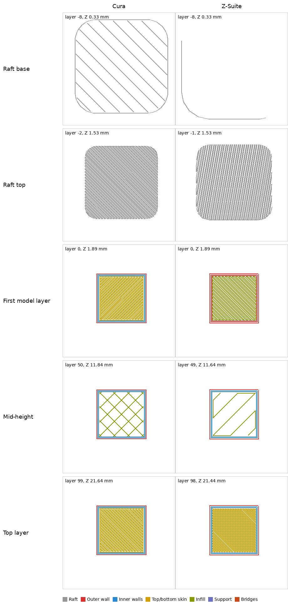

# 20 mm test cube: Cura 5.14 vs Z-Suite 3.7.0

Both files are Z-ABS, 0.20 mm, High quality, with a raft, for the M200 Plus. The Cura file was sliced in headless Cura 5.14 with the Zura presets (`tests/fixtures/cura514-e2e-cube20.zcodex2`). The Z-Suite file is `tests/fixtures/zsuite-cube20.zcodex2`. Regenerate with:

```
python3 tools/compare_zcodex.py tests/fixtures/cura514-e2e-cube20.zcodex2 tests/fixtures/zsuite-cube20.zcodex2 --labels Cura Z-Suite --png-dir docs/screenshots
```



## Overall

| | Cura | Z-Suite |
| --- | --- | --- |
| Print time (slicer estimate) | 32 min | 32 min |
| Filament | 2.04 m / 5.12 g | 2.09 m / 5.00 g |
| Nozzle / bed | 275 / 80 °C | 275 / 80 °C |
| Raft layers / raft top | 7 / 1.53 mm | 7 (+ a cleaning line) / 1.53 mm |
| First and second model layer Z | 1.89 / 2.04 mm | 1.89 / 2.04 mm |
| Model layers / top Z | 100 / 21.64 mm | 99 / 21.44 mm |
| Raft footprint | 37.2 mm | 40.0 mm |
| Retractions | 107 | 158 |
| Travel | 9.1 m | 3.3 m |
| Commands | 12,648 | 6,024 |

## Per feature

| Feature | Path (m) Cura / ZS | Speed (mm/s) Cura / ZS | Filament per mm Cura / ZS |
| --- | --- | --- | --- |
| Raft | 10.76 / 10.75 | 70 / 70 | 0.049 / 0.057 |
| Outer wall | 7.86 / 7.86 | 20 / 20 | 0.033 / 0.037 |
| Inner walls | 14.76 / 14.27 | 20 / 20 | 0.033 / 0.036 |
| Top/bottom skin | 8.60 / 6.83 | 34 / 42 | 0.033 / 0.040 |
| Infill | 14.77 / 8.23 | 67 / 67 | 0.033 / 0.049 |

## Findings

- **Fixed: raft gap.** The first comparison showed Cura printing the first model layer 0.53 mm above the raft and the second only 0.035 mm above the first, and a raft 0.3 mm taller than Z-Suite's. `RaftPlatformGap` had been mapped to `raft_airgap`, but it is the raft base height. Now `raft_airgap = FL_ModelSpace`, `layer_0_z_overlap = FL_SecondLayerLower`, raft middle/top thickness `= RB_RaftDefaultHeight` and `raft_surface_margin = RS_Enlarge`. Raft and first-layer heights now match Z-Suite exactly.
- **Flow.** Cura extrudes the same amount per mm for every feature (0.4 mm line × 0.2 mm layer). Z-Suite extrudes about 11% more on the outer wall, 8% more on inner walls, and about 50% more on infill lines, which it spaces further apart. Total filament ends up about the same, but walls are lighter in Cura. Not mapped yet.
- **Infill pattern.** Cura uses a 20% grid; Z-Suite uses sparse diagonal lines that alternate direction.
- **First layer.** Z-Suite prints the first model layer as dense infill inside two outer contours; Cura prints it as bottom skin. Same result in practice.
- **Travel and Z hop.** Cura travels about 3× further (combing inside the part) and retracts less often. Z-Suite lifts Z by 0.2 mm on every travel over 2 mm (`R_LiftZEnable`, `R_LiftZHeight`, `R_MinLength`); Cura's Z hop is off. Not mapped yet.
- **Height.** Cura's cube ends one layer (0.2 mm) higher.
